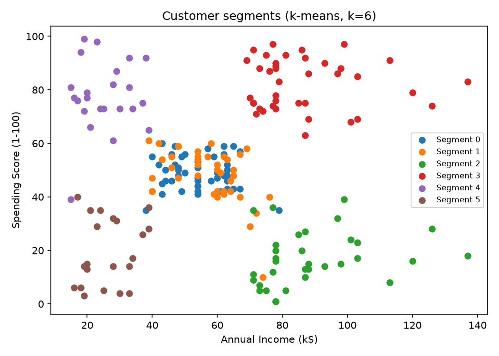
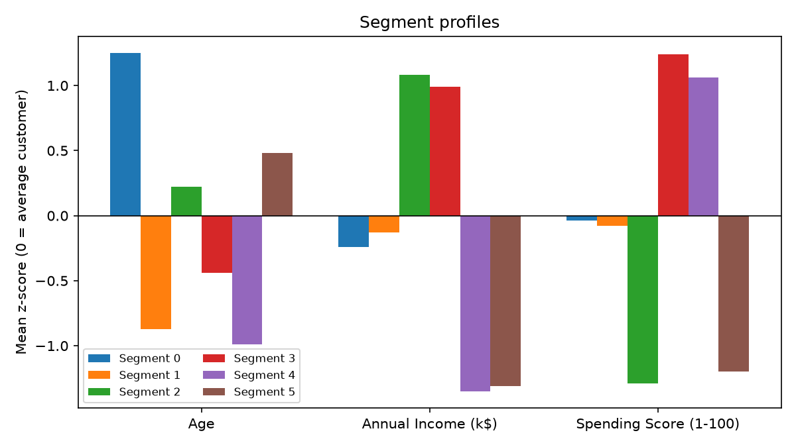
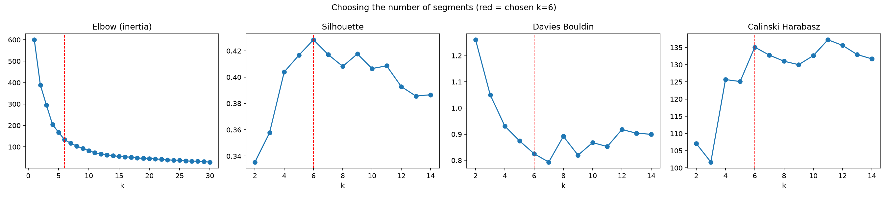

# Mall Customer Segmentation


**Question:** a mall has age, income and a spending score for 200 customers. Which distinct customer groups exist, and which are worth targeting?

**Answer:** six segments. The most valuable are *affluent big spenders* (39 customers, income ~87k, spending score ~82). The biggest missed opportunity is *affluent low spenders* (33 customers, income ~89k, spending score ~17).



## The six segments

k-means on z-scored age, income and spending score (`k=6`, seed 42).

| Segment | n | Avg age | Income (k$) | Spending | Who they are | Suggested action |
|---|---|---|---|---|---|---|
| 3 | 39 | 33 | 87 | 82 | Affluent big spenders | Retain: loyalty and premium offers |
| 2 | 33 | 42 | 89 | 17 | Affluent low spenders | Win over: they have money and are not spending here |
| 4 | 23 | 25 | 25 | 78 | Young, low income, high spending | Promotions, instalment offers |
| 5 | 21 | 46 | 26 | 19 | Low income, frugal | Low priority, discount-driven |
| 1 | 39 | 27 | 57 | 48 | Young, mid income, average spenders | Grow with trend and social campaigns |
| 0 | 45 | 56 | 54 | 49 | Older, mid income, average spenders | Comfort, service and convenience |

Full numbers: [`results/segment_profiles.csv`](results/segment_profiles.csv).



## How k = 6 was chosen

Clustering needs the number of groups up front, and the standard criteria disagree:

| Criterion | Best k |
|---|---|
| Elbow (inertia) | 6 |
| Silhouette | 6 |
| Davies-Bouldin | 7 |
| Calinski-Harabasz | 11 |

Two of four criteria say 6, and Davies-Bouldin is next to it. Calinski-Harabasz favours more, smaller clusters. I chose 6 because it is the value the two most robust criteria agree on, and it gives groups a marketing team can act on. Curves: [`results/k_selection.png`](results/k_selection.png).



## Does the method matter? (k-means vs hierarchical)

All methods were scored at k = 6 on the same scaled data, with the same metric (Euclidean silhouette), so the numbers are directly comparable. ARI is agreement with the k-means partition.

| Method | Silhouette | ARI vs k-means |
|---|---|---|
| k-means | 0.428 | 1.000 |
| Hierarchical (Ward) | 0.420 | 0.891 |
| Hierarchical (average) | 0.390 | 0.734 |
| Hierarchical (complete) | 0.375 | 0.768 |
| Hierarchical (single) | -0.043 | 0.008 |

Ward linkage recovers almost the same segments as k-means (ARI 0.89), so the segmentation is a property of the data, not of the algorithm. Single linkage fails: it chains points together into one huge cluster plus outliers.

## Is gender a useful signal?

Gender was left out of the clustering and checked afterwards. The share of women per segment stays between 42% and 64%, so no segment is strongly gender-skewed. An earlier version of this project also tried to predict gender from the three features with KNN and reached only ~60% accuracy, near chance. Together this says gender adds nothing to segmentation here.

## Limitations

- 200 customers from one mall; the "spending score" is a score assigned by the mall, not actual revenue.
- Only three features. Real segmentation would add visit frequency, basket size and category mix.
- Silhouette is 0.43 at best: the groups are reasonably distinct but touch each other, especially segments 0, 1 and the middle of the income range.
- The suggested actions are hypotheses, not tested interventions.

## Reproduce

```bash
python -m venv .venv && source .venv/bin/activate   # Windows: .venv\Scripts\activate
pip install -r requirements.txt
python run_analysis.py      # regenerates everything in results/
pytest                      # 7 tests
```

## Layout

```
segmentation/   data loading, k selection, clustering and profiling
run_analysis.py reproduces all tables and figures
tests/          unit tests (shapes, scaling, determinism, elbow, profiling)
data/           Mall_Customers.csv (public Kaggle dataset)
results/        figures and CSVs used in this README
```

## History

This repo replaces three earlier method-centred repos: `Customer-Segmentation-kmeans`, `Clustering_Hierarchical` and the customer part of `Classification_KNN`.
